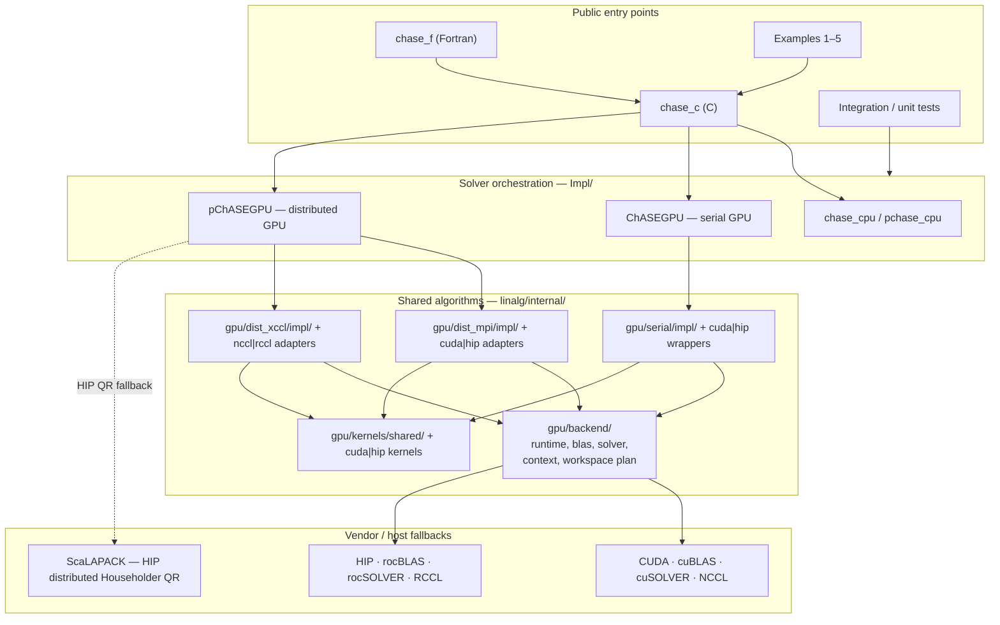
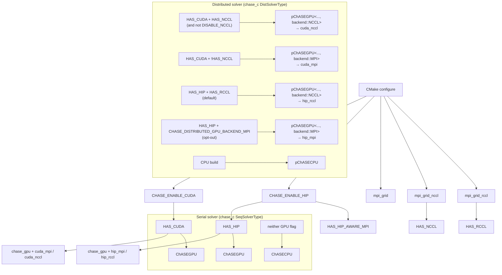
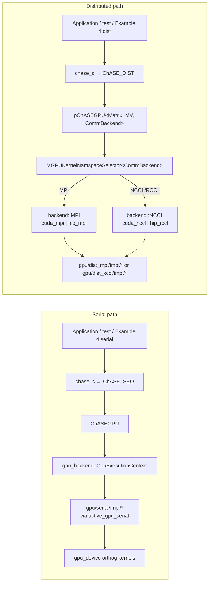
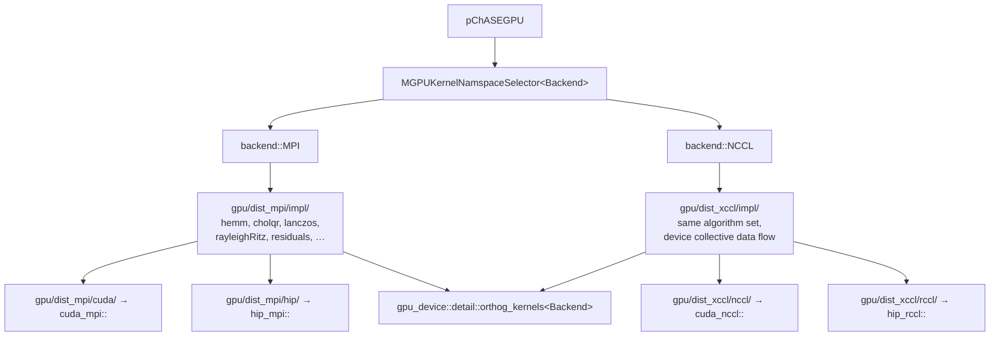
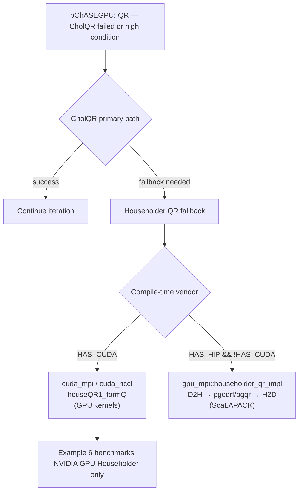
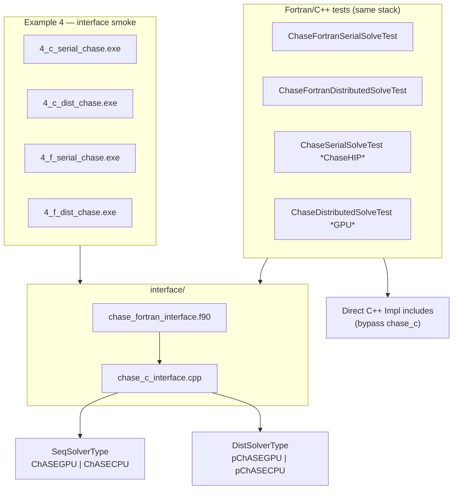
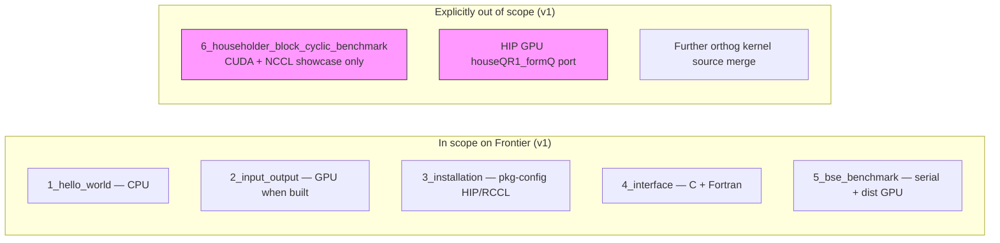
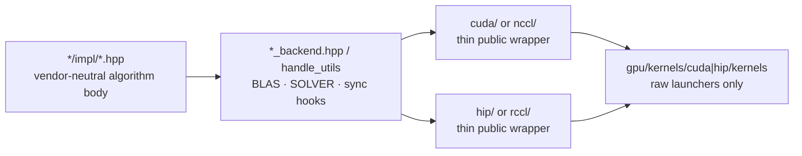

# AMD GPU Port Architecture

Last updated: 2026-07-02.

This document describes the current CUDA/HIP GPU architecture after the AMD
Frontier port convergence work on branch `75-porting-to-amd-on-frontier`.

The goal of the final structure is:

1. Keep CUDA/NVIDIA development possible without requiring a live AMD system.
2. Keep HIP/ROCm behavior isolated behind backend dispatch where APIs differ.
3. Share ChASE algorithm logic across CUDA and HIP whenever the execution model
   is the same.
4. Keep GPU-aware MPI and NCCL/RCCL paths separate, because their communication
   models and optimized algorithms are intentionally different.
5. Keep most GPU memory, solver workspace, and Lanczos/Rayleigh-Ritz operations
   GPU-resident and reusable, following the NVIDIA implementation as the
   behavioral reference.

## Final Convergence Status

The AMD GPU port is considered converged for v1.

User-reported Frontier validation after the final cleanup passed for:

- serial HIP solver;
- serial HIP pseudo-BSE solver;
- distributed HIP-aware MPI solver;
- distributed HIP-aware MPI pseudo-BSE solver;
- distributed RCCL/xCCL solver;
- distributed RCCL/xCCL pseudo-BSE solver;
- Example 4 C and Fortran serial/distributed interface runs;
- the final post-cleanup test set after `fixednev` cleanup and Orthog launcher
  facade consolidation.

The only intentionally deferred item is distributed HIP GPU Householder QR.
AMD uses the documented ScaLAPACK fallback for that path.

## Architecture Diagrams

The diagrams below summarize the converged July 2026 design. They are meant as
navigation aids; file-level detail remains in the sections that follow.

### 1. Layer dependency (top → bottom)

Public entry points sit above solver orchestration (`Impl/`), which calls shared
algorithm layers under `linalg/internal/`, which in turn dispatch to vendor APIs.



### 2. Build-time backend selection

CMake defines compile-time macros; `chase_c` and each example/test target inherit
the subset that applies to that binary.



**Frontier default:** all HIP distributed builds with RCCL linked default to
RCCL (`backend::NCCL` → `hip_rccl`). GPU-aware MPI is opt-out: configure with
`-DCHASE_HIP_DISTRIBUTED_COLLECTIVES=MPI`, which defines
`CHASE_DISTRIBUTED_GPU_BACKEND_MPI` so `DefaultDistributedGpu` resolves to MPI.
The default is centralized in `grid/default_distributed_backend.hpp`
(`chase::grid::backend::DefaultDistributedGpu`). NVIDIA (CUDA + NCCL) behavior is
unchanged and still defaults to NCCL.

### 3. Runtime call chain — serial vs distributed



`SolverWorkspacePlan` is queried once in `ChASEGPU` / `pChASEGPU` constructors;
`GpuExecutionContext::ensure_solver_plan` owns the reusable device workspace.

### 4. MPI stack vs xCCL stack (do not mix)

GPU-aware MPI and NCCL/RCCL are **separate** distributed algorithm families.
`pChASEGPU` picks one at compile time via the `CommBackend` template parameter.



xCCL Lanczos is **not** derived from GPU-aware MPI Lanczos; NCCL behavior is the
reference when changing `gpu/dist_xccl/impl/`.

### 5. Distributed Householder QR routing



### 6. Interface and validation topology



### 7. Examples and AMD v1 scope



### 8. Shared-impl refactor pattern (serial, MPI, xCCL)

Every GPU algorithm family follows the same structural rule after convergence:



New shared logic belongs in `impl/` or `gpu/backend/`, not in duplicated
CUDA/HIP algorithm bodies.

## Top-Level Runtime Split

The public solver implementation is split into CPU, serial GPU, and distributed
GPU frontends:

| Path | Role |
|------|------|
| `Impl/chase_cpu/` | Single-process CPU solver implementation. |
| `Impl/pchase_cpu/` | Distributed CPU pChASE implementation. |
| `Impl/chase_gpu/` | Single-GPU solver orchestration for CUDA or HIP. |
| `Impl/pchase_gpu/` | Distributed GPU pChASE orchestration for GPU-aware MPI and xCCL backends. |

The GPU `Impl/` layer owns solver orchestration:

- high-level vector/matrix buffers;
- `GpuExecutionContext`;
- reusable solver workspace;
- algorithm calls such as filter, QR, Rayleigh-Ritz, residuals, and Lanczos;
- backend selection through compile-time tags.

It should not accumulate new CUDA- or ROCm-specific algorithm branches if the
difference can be represented in `linalg/internal/gpu/backend/`,
`linalg/internal/gpu/kernels/`, or a shared `impl/` directory.

## Backend Tags

GPU backend selection is expressed through backend tags in
`linalg/internal/gpu/backend/types.hpp`.

Conceptually:

```cpp
gpu_backend::cuda_backend
gpu_backend::hip_backend
```

Higher-level shared code should dispatch on these tags, not on CUDA/HIP names
spread throughout algorithm bodies.

This is what allows NVIDIA-only development to remain practical: CUDA builds
instantiate CUDA backend traits and do not need ROCm headers for unrelated work.

## `gpu_backend`: Runtime, BLAS, SOLVER, Context

Directory:

```text
linalg/internal/gpu/backend/
```

This directory is the main backend portability layer.

| File | Responsibility |
|------|----------------|
| `types.hpp` | Backend tags and shared backend type definitions. |
| `runtime.hpp` | CUDA/HIP runtime dispatch: allocation, free, memset, streams, events, synchronization, and matrix copies. |
| `blas.hpp` | BLAS dispatch: cuBLAS for CUDA, rocBLAS for HIP. |
| `solver.hpp` | SOLVER dispatch: cuSOLVER/cusolverpp for CUDA, rocSOLVER/rocsolverpp for HIP. |
| `context.hpp` | `GpuExecutionContext`, owning handles, stream policy, `devInfo`, and reusable device workspace. |
| `workspace_plan.hpp` | Centralized query/planning for QR, POTRF, HEEVD, packed triangular buffers, and host GEEV workspace where applicable. |
| `serial_ops.hpp` | Active serial GPU kernel namespace selection for higher-level `Impl` code. |
| `handle_utils.hpp` | BLAS/solver glue for shared GPU algorithm code (enums, status checks, stream on handle). |

### `GpuExecutionContext`

`GpuExecutionContext<Backend>` is the owner for backend execution resources.

It exists to keep these concerns out of algorithm code:

- BLAS handle lifetime;
- SOLVER handle lifetime;
- stream ownership or default-stream policy;
- `devInfo` allocation;
- main reusable device workspace allocation.

CUDA and HIP differ here:

- CUDA uses separate cuBLAS and cuSOLVER handle types.
- HIP uses `rocblas_handle` for BLAS and rocSOLVER calls, but ChASE still owns
  logically separate handles to avoid accidental aliasing and ordering bugs.

The context is not an algorithm layer. It should not decide between MPI and
xCCL, nor between pseudo-Hermitian GEEV and POTRF/HEEVD paths.

### Workspace Policy

The constructor-level workspace plan is the preferred place to size long-lived
solver buffers.

Rules:

- Query workspace once in `ChASEGPU` or `pChASEGPU` construction.
- Allocate one reusable main device workspace through `GpuExecutionContext`.
- Reuse that workspace in QR, Rayleigh-Ritz, POTRF, HEEVD, and related solver
  calls.
- Keep temporary allocation inside hot kernels as a follow-up optimization
  target unless it is also present in the NVIDIA reference path.

ROCm-specific detail:

- rocSOLVER does not use cuSOLVER-style `*_bufferSize` APIs everywhere.
- HIP workspace queries use the rocBLAS device-memory-size query model where
  necessary, then bind workspace explicitly.

## `gpu_device`: Backend Device Kernels

Directory:

```text
linalg/internal/gpu/kernels/
```

This layer owns small kernels and device-level operations.

| Path | Role |
|------|------|
| `gpu/kernels/cuda/launchers/` | CUDA launcher declarations and CUDA-specific headers. |
| `gpu/kernels/cuda/kernels/` | CUDA kernel translation units. |
| `gpu/kernels/hip/launchers/` | HIP launcher declarations and HIP-specific headers. |
| `gpu/kernels/hip/kernels/` | HIP kernel translation units. |
| `gpu/kernels/shared/` | Backend-neutral facade over CUDA/HIP device kernels. |

Important shared facades:

| File | Role |
|------|------|
| `shared/device_kernels.hpp` | Main CUDA/HIP custom-kernel dispatch, including residuals, flip sign, diagonal shifts, triangular packing, and matrix scaling kernels. Runtime helpers stay in `gpu_backend::runtime.hpp`; BLAS/solver glue in `handle_utils.hpp`; solver dispatch in `gpu_backend::solver`. |
| `shared/orthog_kernels.hpp` | Shared Orthog launcher facade for batched, fused, and pseudo-Hermitian Lanczos kernels. |

### Orthog Launcher Boundary

After convergence, higher-level shared layers should use:

```cpp
gpu_device::detail::orthog_kernels<Backend>
```

for batched/fused orthogonalization helpers.

This facade covers:

- batched norm squared;
- batched dot;
- batched AXPY;
- batched AXPY then negate;
- batched scale and scale-two;
- batched sqrt;
- real extraction and real-to-`T` copies;
- fused norm-squared normalize;
- fused dot/AXPY/negate;
- pseudo-Hermitian single and batched initialization;
- pseudo-Hermitian fused dot/scale/negate/AXPY;
- pseudo-Hermitian lacpy-flip-batched-dot.

CUDA and HIP kernel sources remain backend-specific. The merge is at the
launcher facade level, not by forcing `.cu` and `.hip` kernels into one source
file.

## `gpu_serial`: Single-GPU Algorithms

Directory:

```text
linalg/internal/gpu/serial/
```

This layer owns single-GPU algorithms.

| Path | Role |
|------|------|
| `gpu/serial/impl/` | Shared serial CUDA/HIP algorithm bodies. |
| `gpu/serial/cuda/` | Thin CUDA public wrappers and CUDA-only hooks. |
| `gpu/serial/hip/` | Thin HIP public wrappers and HIP-only hooks. |

Main shared implementation files:

| File | Role |
|------|------|
| `impl/cholqr.hpp` | Shared serial GPU CholQR and Householder QR path. |
| `impl/rayleigh_ritz.hpp` | Shared Hermitian Rayleigh-Ritz. |
| `impl/pseudo_hermitian_rayleigh_ritz.hpp` | Shared pseudo-Hermitian v2 Rayleigh-Ritz using POTRF/HEEVD. |
| `impl/pseudo_hermitian_rayleigh_ritz_v1.hpp` | Legacy/v1 pseudo-Hermitian GEEV path. HIP uses host LAPACK fallback when native GEEV is unavailable. |
| `impl/residuals.hpp` | Shared serial residuals. |
| `impl/lanczos_detail.hpp` | Shared serial GPU-resident Lanczos algorithms. |
| `impl/lanczos_device_kernels.hpp` | Thin serial wrapper over `gpu_device::detail::orthog_kernels<Backend>`. |
| `impl/lanczos_runtime.hpp` | Lanczos runtime/workspace support. |
| `gpu/backend/handle_utils.hpp` | BLAS/solver glue for serial and distributed GPU algorithms. |

Serial GPU policy:

- CUDA/NVIDIA remains the behavioral reference.
- HIP should follow the same GPU-resident algorithm structure unless ROCm lacks
  an API or Frontier behavior forces a specific workaround.
- Pseudo-Hermitian full solves on HIP should use the v2 POTRF/HEEVD path.
- The GEEV fallback exists for low-level/unit coverage, not as the main pChASE
  production path.

## `gpu_mpi`: GPU-Aware MPI Path

Directory:

```text
linalg/internal/gpu/dist_mpi/
```

This layer owns the GPU-aware MPI implementation. It is separate from xCCL by
design.

| Path | Role |
|------|------|
| `gpu/dist_mpi/impl/` | Shared CUDA/HIP-aware MPI algorithm bodies. |
| `gpu/dist_mpi/cuda/` | CUDA-aware MPI namespace wrappers and CUDA-only hooks. |
| `gpu/dist_mpi/hip/` | HIP-aware MPI namespace wrappers and HIP-only hooks. |

Main shared implementation files:

| File | Role |
|------|------|
| `impl/hemm_impl.hpp` | Shared distributed GPU-aware MPI HEMM. |
| `impl/residuals.hpp` | Shared residuals with HIP-specific residual broadcast hook where required. |
| `impl/cholqr_impl.hpp` | Shared distributed CholQR variants. |
| `impl/rayleighRitz_impl.hpp` | Shared Hermitian Rayleigh-Ritz skeleton. |
| `impl/pseudo_hermitian_rayleighRitz_impl.hpp` | Shared pseudo-Hermitian Rayleigh-Ritz. |
| `impl/lanczos_impl.hpp` | Shared Hermitian Lanczos with GPU-aware MPI communication pattern. |
| `impl/pseudo_hermitian_lanczos_impl.hpp` | Shared pseudo-Hermitian Lanczos. |
| `impl/flip_sign_impl.hpp` | Shared sign-flip operation. |
| `impl/shift_diagonal_impl.hpp` | Shared diagonal shift operation. |
| `impl/sym_or_herm_impl.hpp` | Shared symmetrize/hermitianize helper. |
| `impl/mpi_collectives.hpp` | MPI collective helpers. |
| `impl/collective_policy.hpp` | Policy helpers for collective behavior. |

GPU-aware MPI policy:

- Do not rewrite this path to look like NCCL/RCCL.
- It may use MPI collectives and conservative scalar/host synchronization
  inherited from the CUDA-aware MPI implementation.
- Device-buffer MPI collectives synchronize through `gpu/backend/runtime.hpp`
  (`gpu_backend::active_backend`) before and after MPI calls. The shared MPI
  collective helper must not include legacy CUDA utility headers directly.
- HIP-specific MPI behavior should be isolated in explicit hooks, not hidden in
  algorithm code.

Known intentional HIP detail:

- HIP MPI Lanczos float dot/nrm2 uses a GPU-resident double-accumulation
  reduction for Frontier stability; only the final scalar is copied to host.

## `gpu_xccl`: NCCL/RCCL Collective Path

Directory:

```text
linalg/internal/gpu/dist_xccl/
```

This layer owns NCCL/RCCL collective implementations.

| Path | Role |
|------|------|
| `gpu/dist_xccl/impl/` | Shared NCCL/RCCL algorithm bodies. |
| `gpu/dist_xccl/nccl/` | NVIDIA NCCL namespace wrappers and CUDA-only collective hooks. |
| `gpu/dist_xccl/rccl/` | AMD RCCL namespace wrappers and HIP-only collective hooks. |

Main shared implementation files:

| File | Role |
|------|------|
| `impl/cholqr_impl.hpp` | Shared xCCL CholQR variants. |
| `impl/residuals_impl.hpp` | Shared xCCL residual computation. |
| `impl/hemm_impl.hpp` | Shared xCCL HEMM. |
| `impl/lanczos_impl.hpp` | Shared xCCL Hermitian Lanczos. |
| `impl/lanczos_detail.hpp` | xCCL Lanczos input validation helpers. |
| `impl/pseudo_hermitian_lanczos_impl.hpp` | Shared xCCL pseudo-Hermitian Lanczos. |
| `impl/rayleigh_ritz_impl.hpp` | Shared Hermitian Rayleigh-Ritz. |
| `impl/pseudo_hermitian_rayleigh_ritz_impl.hpp` | Shared pseudo-Hermitian Rayleigh-Ritz. |
| `impl/residuals.hpp` | Shared xCCL residuals. |

xCCL policy:

- Preserve the NVIDIA NCCL execution model as the reference.
- Keep GPU-resident data flow.
- Preserve batched operations where the NCCL reference uses them.
- Preserve fused operations where the NCCL reference uses them.
- Use RCCL as the HIP collective backend, even if the public compatibility test
  names still contain `GPUNCCL`.

Do not derive xCCL Lanczos from GPU-aware MPI Lanczos. These paths are
conceptually different and should stay that way.

## Matrix GPU Portability Layer

The matrix layer still has portability files such as:

- `matrix_gpu_runtime.hpp`;
- `dist_gpu_portability.hpp`.

These are not legacy CUDA-name compatibility bridges. They define matrix-level
GPU behavior and forward runtime operations into `gpu_backend::runtime`.

Do not delete them just because the filenames look generic. They are part of
the matrix/distributed-matrix boundary.

## Interface And Examples

The C and Fortran interface layer is under:

```text
interface/
```

Important behavior after the AMD port:

- `chase_c` and `chase_f` can link GPU implementations in HIP builds.
- Feature queries expose HIP/RCCL availability.
- pkg-config reports HIP/RCCL feature availability.
- Example 4 C/Fortran serial and distributed runs are part of the final AMD
  validation.

Examples:

| Example | AMD status |
|---------|------------|
| `1_hello_world` | CPU path unchanged. |
| `2_input_output_*` | GPU variants support HIP where GPU build is enabled. |
| `3_installation` | pkg-config and interface feature reporting support HIP/RCCL. |
| `4_interface` | C and Fortran serial/distributed interface examples validated. |
| `5_bse_benchmark` | HIP GPU paths enabled where applicable. |
| `6_householder_block_cyclic_benchmark` | CUDA/NCCL-only showcase, intentionally excluded from HIP v1. |

## QR Policy

QR behavior intentionally differs by backend for distributed Householder QR.

| Layer | NVIDIA | AMD |
|-------|--------|-----|
| Serial GPU CholQR / Householder fallback | GPU path through shared serial impl and cuSOLVER | GPU path through shared serial impl and rocSOLVER |
| Distributed CholQR | Shared GPU distributed impl | Shared GPU distributed impl |
| Distributed Householder QR fallback | Custom GPU/NCCL implementation | ScaLAPACK fallback by policy |
| Example 6 | Built and used as NVIDIA Householder QR showcase | Not part of HIP v1 |

This is not considered porting debt for v1.

## `fixednev` Cleanup

The stale `fixednev` argument was removed from:

- `ChaseBase::QR`;
- `ChaseBase::Resd`;
- CPU/GPU serial implementations;
- CPU/GPU distributed implementations;
- performance wrapper;
- algorithm call sites.

`ReinitColumns` still takes a base column offset, now named `base_col`, because
that value is semantically required to map local unconverged indices into the
full subspace.

## Test Baseline

Use the Frontier module helper first:

```bash
source scripts/frontier_hip_env.sh
```

Recommended post-change smoke after touching shared GPU code:

```bash
cmake --build build-frontier-hip -j16

srun -n 1 --gpus-per-task=1 ./tests/ChaseSerialSolveTest \
  --gtest_filter='*ChaseHIP*'

srun -n 1 --gpus-per-task=1 ./tests/ChaseSerialSolvePseudoBSETest \
  --gtest_filter='*CPU_and_GPU/1/*'

srun -n 4 --gpus-per-task=1 ./tests/ChaseDistributedSolveTest \
  --gtest_filter='*GPU*'

srun -n 4 --gpus-per-task=1 ./tests/ChaseDistributedSolvePseudoBSETest \
  --gtest_filter='*GPU*'

srun -n 4 --gpus-per-task=1 ./tests/ChaseDistributedSolveGPUNCCLTest \
  --gtest_filter='*GPU*'

srun -n 4 --gpus-per-task=1 ./tests/ChaseDistributedSolvePseudoBSEGPUNCCLTest \
  --gtest_filter='*GPU*'
```

For broader Frontier validation:

```bash
srun -n 4 --gpus-per-task=1 bash scripts/run_hip_e2e_tests.sh
```

## Maintenance Rules

Use these rules for future agents:

1. Develop shared GPU logic NVIDIA-first when Frontier is not available.
2. Keep CUDA/NVIDIA as the behavior reference.
3. Run Frontier regression when touching:
   - `linalg/internal/gpu/backend/`;
   - `linalg/internal/gpu/kernels/shared/`;
   - `linalg/internal/gpu/serial/impl/`;
   - `linalg/internal/gpu/dist_mpi/impl/`;
   - `linalg/internal/gpu/dist_xccl/impl/`;
   - `Impl/chase_gpu/`;
   - `Impl/pchase_gpu/`;
   - `interface/`;
   - GPU examples.
4. Do not mix `gpu_mpi` and `gpu_xccl`.
5. Do not reintroduce CUDA-name compatibility bridges for shared logic.
6. Keep backend-specific raw API calls in backend layers or backend-private
   wrappers.
7. Keep long-lived solver workspace constructor-owned wherever possible.
8. Treat HIP distributed GPU Householder QR as deferred unless priority changes.

## Convergence Summary

For AMD v1, the port is complete enough to converge.

Remaining future work is optional and should be separate from the v1 merge:

- performance tuning on larger Frontier cases;
- possible HIP distributed GPU Householder QR port if it becomes a priority;
- cleanup of backend-private wrappers after include-graph proof;
- NVIDIA/NCCL full regression before release if not already covered by CI or
  queue availability.
