# AMD Port Convergence Plan

Last updated: 2026-07-02.

This document is the **Definition of Done and final convergence record** for closing MR 102 / branch
`75-porting-to-amd-on-frontier`. It supersedes open-ended refactor items in
`docs/frontier_amd_gpu_porting_plan.md` for the final convergence phase.

Background and Frontier access/build instructions remain in
`docs/frontier_amd_gpu_porting_plan.md`.

The final architecture summary — including **layer dependency, build-time
backend selection, MPI vs xCCL, QR routing, and example scope diagrams** — is in
[`docs/amd_gpu_port_architecture.md`](amd_gpu_port_architecture.md#architecture-diagrams).

---

## Goal

Ship a **maintainable AMD (Frontier/ROCm) port** that:

1. Compiles and passes integration tests on Frontier.
2. Exposes **C and Fortran interfaces** on AMD.
3. Builds and runs **all in-scope examples** on AMD.
4. Documents intentional **NVIDIA vs AMD behavioral differences** (especially QR).
5. Leaves a clear boundary so development can move back to **NVIDIA-first**,
   with Frontier regression when shared GPU layers change.

---

## Scope (In)

| Phase | Item | Description |
|-------|------|-------------|
| **v1** | `SolverWorkspacePlan` | Completed: centralized solver buffer sizing and reusable device workspace allocation via `GpuExecutionContext`. |
| **v1** | MPI Lanczos audit + naming | Completed: HIP float dot/nrm2 uses GPU-resident double-accumulation reduction; production paths use backend-neutral naming where practical. |
| **v1** | C / Fortran interface | `chase_c` / `chase_f` compile and smoke-run on Frontier (serial + distributed MPI GPU path). |
| **v1** | Examples (AMD) | All examples except the documented CUDA-only exception (see below). |
| **v1** | QR differentiation docs | NVIDIA custom GPU distributed Householder QR vs AMD ScaLAPACK fallback — **by design**. |
| **v1 cleanup** | `fixednev` cleanup | Completed: removed stale `fixednev` from `QR` / `Resd`; kept `ReinitColumns(base_col, ...)` because the offset is semantically required. |
| **v1 cleanup** | Orthog launcher facade merge | Completed: higher-level serial/MPI/xCCL paths route through `gpu_device::detail::orthog_kernels<Backend>` for batched/fused orthog launchers. |

---

## Explicitly Out of Scope

| Item | Rationale |
|------|-----------|
| GPU `houseQR1_formQ` on HIP | AMD distributed QR fallback uses ScaLAPACK (`householder_qr_impl`). |
| MPI pseudo-HRR v1 ↔ serial impl reuse (Next 2) | Legacy GEEV path; Frontier uses v2 POTRF/HEEVD for solves. |
| Householder QR port to HIP | Replaced by ScaLAPACK policy on AMD (see QR section). |
| Example 6 (`householder_block_cyclic_benchmark`) | **NVIDIA-only showcase** for custom GPU Householder QR + NCCL. |
| NVIDIA-wide refactor | Post-convergence; NVIDIA remains behavioral reference. |

---

## Backend QR Policy (Showcase)

Intentional differentiation — not a porting debt.

| Layer | NVIDIA | AMD (Frontier) |
|-------|--------|----------------|
| **Distributed Householder QR fallback** (CholQR failure / high condition) | Custom GPU `houseQR1_formQ` in `linalg/internal/gpu/dist_mpi/cuda/householder_qr.hpp` (+ NCCL variants in `gpu/dist_xccl/nccl/`) | **ScaLAPACK** via `gpu_mpi::householder_qr_impl` (`pgeqrf` / `pgqr`, D2H → CPU → H2D) |
| **CholQR primary path** | Shared `gpu/dist_mpi/impl/cholqr_impl.hpp` (GPU) | Same shared impl (GPU, rocBLAS/rocSOLVER) |
| **Serial GPU Householder** | cuSOLVER via `gpu/serial/impl/cholqr.hpp` | rocSOLVER via same shared serial impl |
| **Example 6 benchmark** | Built with `HAS_CUDA` + `HAS_NCCL` | Not built on HIP (documented) |

Routing in `Impl/pchase_gpu/pchase_gpu.hpp`:

- `#if HAS_HIP && !HAS_CUDA` → `kernelNamespace::houseHoulderQR` → ScaLAPACK impl.
- Else → `houseQR1_formQ` (NVIDIA GPU path).

**Build requirement:** HIP distributed builds (`pchase_gpu` + MPI) should enable
ScaLAPACK (`HAS_SCALAPACK`). Without it, distributed Householder QR throws at
runtime.

---

## v1 Acceptance Checklist

### A. Build & tests (Frontier)

- [x] Full HIP configure + build succeeds (user-reported compile pass).
- [x] Serial HIP targeted solve validation user-reported pass.
- [x] Distributed HIP targeted solve validation user-reported pass.
- [x] Integration: `ChaseDistributedSolveTest`, `ChaseDistributedSolvePseudoBSETest` (`*GPU*`) user-reported pass.
- [x] xCCL integration: `ChaseDistributedSolveGPUNCCLTest`, `ChaseDistributedSolvePseudoBSEGPUNCCLTest` (`*GPU*`) user-reported pass.
- [x] Serial solve smoke: `ChaseSerialSolveTest` (`*ChaseHIP*`) and `ChaseSerialSolvePseudoBSETest` (`*CPU_and_GPU/1/*`) user-reported pass.
- [x] C/F interface and Example 4 C/Fortran serial/distributed smoke user-reported pass.
- [x] Final post-cleanup test set after Orthog launcher merge and `fixednev` cleanup user-reported pass.

### B. Next 1 — `SolverWorkspacePlan`

- [x] `linalg/internal/gpu/backend/workspace_plan.hpp` defines plan + query helpers.
- [x] `ChASEGPU` constructor uses plan for device workspace sizing.
- [x] `pChASEGPU` constructor uses plan (HIP skips geqrf/gqr queries — ScaLAPACK QR policy).
- [x] Host GEEV workspace (`h_work_`, `lhwork_`) sized from plan where applicable (CUDA XGEEV).
- [x] `GpuExecutionContext` owns reusable device workspace and now shares one generic implementation body across CUDA/HIP handle traits.
- [x] No change in numerical behavior in targeted Frontier smoke/integration tests (user-reported).

### C. Next 3 — MPI Lanczos + naming

- [x] HIP `float` dot/nrm2 in MPI Lanczos uses a device reduction with double accumulation; only the final scalar is copied back to host.
- [x] Production `gpu/dist_mpi/impl/*` and `Impl/*` free of misleading `get_cublas_*` (none in production paths; test fixtures only).
- [x] `linalg/internal/gpu/dist_mpi/hip/README.md` updated with QR policy + Lanczos reduction behavior.
- [x] Serial Lanczos CUDA/HIP implementations share `gpu/serial/impl/lanczos_detail.hpp`; wrapper comments are backend-neutral.

### D. C / Fortran interface

- [x] `interface/chase_c` links `chase_gpu` / `pchase_gpu` with `HAS_HIP` on Frontier.
- [x] C API exposes HIP/RCCL feature queries (`chase_has_hip_`, `chase_has_rccl_`) and pkg-config reports `chase_has_hip` / `chase_has_rccl`.
- [x] Examples `4_c_serial_chase`, `4_c_dist_chase`, `4_f_serial_chase`, `4_f_dist_chase` user-reported pass.
- [x] `examples/3_installation`: pkg-config HIP/RCCL feature reporting updated; final C/F executable smoke covered by Example 4 interface runs.

### E. Examples (AMD)

| Example | AMD expectation |
|---------|-----------------|
| `1_hello_world` | CPU (unchanged) |
| `2_input_output_*` | GPU variants link `chase_gpu` / `pchase_gpu` (no hardcoded `HAS_CUDA`) |
| `3_installation` | GPU + C + Fortran when enabled |
| `4_interface` | C + Fortran via `chase_c` / `chase_f` |
| `5_bse_benchmark` | GPU serial + GPU distributed MPI/xCCL paths enabled for HIP where GPU support is built |
| `6_householder_block_cyclic_benchmark` | **Excluded** — CUDA/NCCL only (NVIDIA showcase) |

### F. Documentation

- [x] This file records current v1 status and remaining validation.
- [x] QR policy visible in HIP README and this plan.
- [x] Final GPU architecture documented in `docs/amd_gpu_port_architecture.md`
  (includes mermaid layer, build-time, MPI/xCCL, QR, and example-scope diagrams).

---

## Convergence scope (diagram)

```mermaid
flowchart TB
  v1["v1 — merged / user-reported green"]

  v1 --> n1["SolverWorkspacePlan + GpuExecutionContext"]
  v1 --> n3["Lanczos docs + backend-neutral naming"]
  v1 --> iface["C/Fortran interface + Example 4"]
  v1 --> ex["Examples 1–5 on HIP"]
  v1 --> qr_doc["QR policy documented<br/>(ScaLAPACK on AMD)"]
  v1 --> cleanup["fixednev cleanup + orthog launcher facade"]

  defer["Deferred / out of v1"]
  defer --> e6["Example 6 — CUDA/NCCL only"]
  defer --> hip_qr["HIP GPU houseQR1_formQ"]
  defer --> geew["MPI pseudo-HRR v1 ↔ serial reuse"]
  defer --> perf["Large-case performance tuning"]

  post["Post-v1 maintenance"]
  post --> nvidia_first["NVIDIA-first development"]
  post --> frontier_reg["Frontier regression on shared GPU layers"]
```



## Current Architecture Snapshot

The intended layering after the July 2026 convergence work is:

| Layer | Role | Notes |
|-------|------|-------|
| `gpu/backend/` | Backend dispatch for runtime, BLAS, SOLVER, handle context, workspace plan | Shared by serial and distributed GPU implementations; NVIDIA-only development should work here with CUDA traits alone. |
| `gpu/serial/impl/` | Shared single-GPU algorithms | CholQR, Rayleigh-Ritz, residuals, syevd, pseudo-HRR and Lanczos live here. CUDA/HIP folders should stay thin adapters. |
| `gpu/dist_mpi/impl/` | Shared GPU-aware MPI algorithms | Separate from xCCL by design; uses MPI collectives and must not be replaced by xCCL logic. |
| `gpu/dist_xccl/impl/` | Shared NCCL/RCCL algorithms | Keeps the xCCL-specific batched/fused collective data flow; use NCCL master behavior as reference. |
| `gpu/dist_mpi/cuda`, `gpu/dist_mpi/hip`, `gpu/dist_xccl/nccl`, `gpu/dist_xccl/rccl` | Adapter namespaces and backend-specific kernel entry points | Keep these folders as thin wrappers plus truly backend-only kernels. |
| `dist_gpu_portability.hpp`, `matrix_gpu_runtime.hpp` | Matrix/distributed-matrix GPU portability boundary | Keep for now; these are not legacy compatibility bridges. |

Legacy CUDA-name compatibility headers should not be reintroduced. New runtime,
BLAS, SOLVER, and workspace behavior belongs in `gpu/backend/` or the relevant
shared `impl/` directory.

See [`amd_gpu_port_architecture.md`](amd_gpu_port_architecture.md#architecture-diagrams)
for visual summaries of this layering.

---

## Remaining Structural Work

### P0 — v1 closure

Complete. The user reported the final Frontier test set passed after the final
cleanup commits.

### P1 — post-v1 maintenance

- Audit `gpu/serial/cuda/*` and `gpu/serial/hip/*` periodically: wrappers should remain thin adapters over `gpu/serial/impl/*`.
- Audit `gpu/dist_xccl/impl/lanczos_impl.hpp` against NVIDIA NCCL master before any behavior change; do not derive xCCL Lanczos from GPU-aware MPI Lanczos.
- Remove only genuinely unused adapter files after include-graph proof; do not delete portability files that still define matrix-layer GPU behavior.
- Run NVIDIA/NCCL regression before release if CI or queue availability allows.

### P2 — deferred work

- HIP distributed Householder QR remains deferred; AMD uses the ScaLAPACK fallback by policy.
- Performance tuning on larger Frontier cases is post-v1 work.

---

## Execution Order (v1)

1. **Record plan** (this document).
2. **Next 1** — `SolverWorkspacePlan` + refactor `ChASEGPU` / `pChASEGPU`.
3. **Next 3** — Lanczos reduction docs + naming pass.
4. **Examples + interface** — CMake and source fixes for HIP; ScaLAPACK guard for HIP `pchase_gpu`.
5. **Frontier validation** — user runs e2e; fix regressions.
6. **Merge MR 102** — port functionally complete.
7. **Final cleanup** — stale `fixednev` API removal and Orthog launcher facade merge.

Remaining v1 effort: **complete**.

---

## Post-Convergence Maintenance (NVIDIA-first)

After v1 merge:

1. **Default development on NVIDIA** (CUDA/NCCL reference).
2. **Frontier regression** when touching any of:
   - `linalg/internal/gpu/backend/`
   - `linalg/internal/gpu/serial/impl/`
   - `linalg/internal/gpu/dist_mpi/impl/`
   - `linalg/internal/gpu/dist_xccl/impl/`
   - `Impl/chase_gpu/`, `Impl/pchase_gpu/`
   - `interface/`
   - `examples/` GPU paths
3. **No Frontier run required** for changes confined to:
   - `linalg/internal/gpu/dist_mpi/cuda/householder_qr.hpp`
   - `linalg/internal/gpu/dist_xccl/nccl/householder_qr.hpp`
   - Example 6
4. **AMD QR path** stays ScaLAPACK unless product priority explicitly changes.

---

## Frontier Smoke Commands (v1 sign-off)

```bash
source scripts/frontier_hip_env.sh
cmake --build build-frontier-hip -j16

# Full e2e (kernels + solve + interface)
srun -n 4 --gpus-per-task=1 bash scripts/run_hip_e2e_tests.sh

# Interface examples (after build)
srun -n 1 --gpus-per-task=1 ./examples/4_interface/4_c_serial_chase.exe
srun -n 4 --gpus-per-task=1 ./examples/4_interface/4_c_dist_chase.exe
```

---

## Status Log

| Date | Milestone | Notes |
|------|-----------|-------|
| 2026-07-01 | Plan recorded | Convergence scope locked: Next 1 + Next 3 + examples/interface; Orthog initially deferred; Example 6 CUDA-only; QR ScaLAPACK policy on AMD. |
| 2026-07-01 | v1 work started | `SolverWorkspacePlan`, example 5 HIP paths, QR policy docs, ScaLAPACK CMake warning. |
| 2026-07-01 | Serial Lanczos unified | `294a29e` HIP build fix after impl merge. |
| 2026-07-02 | Targeted integration reported green | Serial HIP solve, serial pseudo-BSE, distributed HIP-MPI solve/pseudo-BSE, distributed xCCL solve/pseudo-BSE reported passing on Frontier. |
| 2026-07-02 | Context and wrapper cleanup | `GpuExecutionContext` generic body added; serial Lanczos comments and adapter wording made backend-neutral. |
| 2026-07-02 | Example 4 interface examples green | User reported all Example 4 C/Fortran serial/distributed examples passing on Frontier. |
| 2026-07-02 | Final cleanup completed | `fixednev` removed from stale `QR` / `Resd` APIs; Orthog launcher dispatch merged through shared facade. |
| 2026-07-02 | AMD v1 converged | User reported final test set passing after cleanup; port is ready to converge with distributed HIP Householder QR intentionally deferred. |

This table records the final v1 convergence state.
