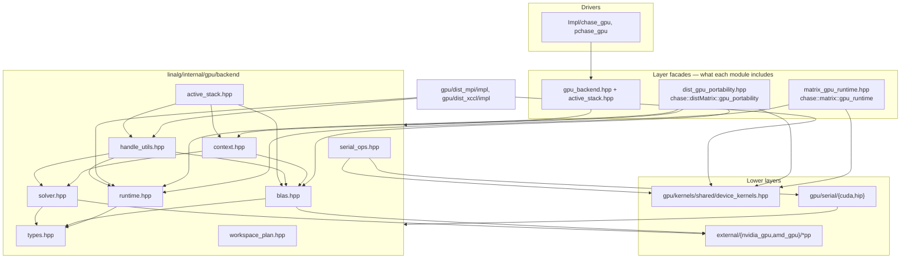

# `gpu/backend` — CUDA/HIP portability layer

ChASE’s GPU code is split into **layers**. `linalg/internal/gpu/backend/` is the
**vendor-neutral dispatch layer**: it selects CUDA or HIP at compile time and
forwards to typed wrappers under `external/` and ChASE-owned kernels under
`linalg/internal/gpu/kernels/`.

The C++ namespace is still `chase::linalg::internal::gpu_backend`; the directory
name describes the architectural layer.

Algorithm code should talk to **`gpu_backend` APIs** (or the thin facades built
on top of them), not to `cuda*` / `hip*` / `cublas*` / `rocblas*` directly.

---

## Role in the stack



### Why three facades?

| Facade | Namespace | Used by | Covers |
|--------|-----------|---------|--------|
| **`gpu_backend.hpp`** | `gpu_backend::` | `ChASEGPU`, `pChASEGPU` | Full serial driver stack + `active_stack` type bundle |
| **`matrix_gpu_runtime.hpp`** | `matrix::gpu_runtime` | `Matrix<T, GPU>`, mixed-precision in `matrix.hpp` | Alloc/free, pinned host, H2D/D2H, precision conversion |
| **`dist_gpu_portability.hpp`** | `distMatrix::gpu_portability` | `distMatrix.hpp`, `distMultiVector.hpp` | `lacpy`, conjugate, BLAS swap, GPU-aware MPI, NCCL/RCCL |

Each facade exposes only what its layer needs. They all delegate into
`gpu_backend` (and thus share one `active_backend` tag), but **upper layers do
not include each other’s headers**.

**Memory rule of thumb**

- **Serial matrix lifetime** (device buffer, pinned CPU mirror, `H2D`/`D2H`) →
  `matrix::gpu_runtime` → `Matrix<T, GPU>`.
- **Distributed layout / redistribute / collectives** →
  `distMatrix::gpu_portability`, while local tiles still live in `Matrix<T, GPU>`.

---

## Backend selection

Defined in `runtime.hpp` (and repeated conceptually everywhere):

| CMake / preprocessor | Tag | Libraries |
|----------------------|-----|-----------|
| `HAS_CUDA` | `cuda_backend` | cuBLAS, cuSOLVER, CUDA runtime |
| `HAS_HIP` (no CUDA) | `hip_backend` | rocBLAS, rocSOLVER, HIP runtime |

`active_backend` aliases whichever backend the current translation unit is
built with. CUDA wins if both are defined.

Shared code dispatches with templates, e.g. `blas<Backend>`, `runtime<Backend>`,
`gpu_device::kernels<Backend>`, instead of scattering `#if defined(HAS_CUDA)`.

---

## File guide

| File | Purpose | Main dependencies | Typical callers |
|------|---------|-------------------|-----------------|
| **`types.hpp`** | Backend tags (`cuda_backend`, `hip_backend`) and forward `traits<>` | — | Every dispatch header |
| **`error.hpp`** | `CHECK_CUDA_ERROR` / `CHECK_HIP_ERROR` helpers | vendor runtime headers | `runtime.hpp`, MPI GPU collectives, device code |
| **`runtime.hpp`** | Device alloc/free, memset, streams, events, sync, matrix H2D/D2H; typed free-function helpers (`device_malloc`, `memcpy_d2h`, …) | `types.hpp`, CUDA/HIP runtime | `matrix_gpu_runtime`, `context`, `dist_gpu_portability`, algorithm impl |
| **`blas.hpp`** | BLAS facade → `cublaspp` / `rocblaspp` | `types.hpp`, `external/*pp` | `handle_utils`, `context`, algorithms, `dist_gpu_portability` (`t_swap`) |
| **`solver.hpp`** | Solver facade → `cusolverpp` / `rocsolverpp`; `traits` specializations | `types.hpp`, `external/*pp` | `handle_utils`, `context`, serial/distributed RR |
| **`context.hpp`** | `GpuExecutionContext<Backend>` — owns BLAS/solver handles, optional stream, `devInfo`, reusable solver workspace | `runtime.hpp`, `solver.hpp`, `workspace_plan.hpp` | `ChASEGPU`, `pChASEGPU`, tests |
| **`workspace_plan.hpp`** | Constructor-time aggregation of QR / POTRF / HEEVD (and related) workspace sizes | `solver.hpp` | Drivers during init |
| **`handle_utils.hpp`** | BLAS/solver glue only: enum constants, status checks, stream binding on existing handles | `blas.hpp`, `runtime.hpp`, `solver.hpp` | `gpu/dist_mpi/impl`, `gpu/dist_xccl/impl`, `gpu/serial/impl` |
| **`serial_ops.hpp`** | Pulls active `gpu/serial/{cuda,hip}/serial_kernels.hpp` + orthog launchers | `types.hpp`, `gpu/serial/*`, `gpu/kernels/*` | Included via `gpu_backend.hpp`; Lanczos / CholQR / RR stages |
| **`active_stack.hpp`** | `backend_stack<Backend>` / `active_stack` — bundled aliases (solver, blas, runtime, handle_utils, kernels, handles, `device_deleter`) | `blas.hpp`, `context.hpp`, `runtime.hpp`, `solver.hpp`, `handle_utils.hpp`, `gpu/kernels/shared/device_kernels.hpp` | `ChASEGPU`, `pChASEGPU` (via `gpu_backend.hpp`) |
| **`gpu_backend.hpp`** | **Umbrella include** for serial drivers: `serial_ops` + workspace plan + `active_stack` | headers above | `Impl/chase_gpu`, `Impl/pchase_gpu` |

ChASE-owned device kernels live in **`gpu/kernels/shared/device_kernels.hpp`** — include
that header directly from matrix/dist facades and algorithm code; there is no
`device_kernels.hpp` alias in `gpu_backend` anymore.

---

## `GpuExecutionContext` vs `handle_utils`

| | `GpuExecutionContext<Backend>` | `handle_utils<Backend>` |
|--|--------------------------------|------------------------|
| **Ownership** | Owns handles, stream policy, `devInfo`, main workspace | Stateless BLAS/solver helpers |
| **Lifetime** | One per GPU driver / long-lived scope | Call sites pass existing handles |
| **Use when** | `ChASEGPU`, `pChASEGPU`, tests that mirror drivers | Distributed GPU kernels (`gpu/dist_mpi`, `gpu/dist_xccl`), shared `gpu/serial/impl` |
| **Runtime (malloc, memcpy, streams)** | Via `runtime.hpp` on the context’s stream | Via **`runtime.hpp` free functions**, not `handle_utils` |

Do not put algorithm policy (MPI vs NCCL, GEEV vs HEEVD) inside the context.

---

## `backend_stack` / `active_stack`

Drivers used to repeat a block of `#if HAS_HIP` aliases. `active_stack.hpp` centralizes:

```cpp
using gpu = chase::linalg::internal::gpu_backend::active_stack;
// gpu::blas, gpu::solver, gpu::runtime, gpu::handle_utils, gpu::kernels,
// gpu::execution_context, gpu::blas_handle, …
```

Include via `gpu_backend.hpp` when a file needs the full serial GPU toolchain.
Finer headers (`blas.hpp` only, etc.) remain valid for narrow includes.

---

## Downstream dependencies (what sits below)

```text
external/
├── nvidia_gpu/cublaspp, cusolverpp   ← linked by CMake chase_nvidia_gpu_linalg
└── amd_gpu/rocblaspp, rocsolverpp    ← linked by CMake chase_amd_gpu_linalg

linalg/internal/gpu/kernels/
├── shared/device_kernels.hpp         ← public backend-neutral kernel dispatch
├── shared/orthog_kernels.hpp         ← public Orthog/Lanczos kernel facade
├── shared/impl/                      ← private shared kernel bodies
├── cuda/launchers + cuda/kernels     ← NVIDIA launchers and translation units
└── hip/launchers + hip/kernels       ← AMD launchers and translation units

linalg/internal/gpu/serial/{cuda,hip} ← serial algorithm entry points (Lanczos, CholQR, …)
```

`gpu_backend` **does not** own kernel source files; it **routes** to them.

---

## Upstream dependencies (what sits above)

| Layer | Header | Relationship to `gpu_backend` |
|-------|--------|-------------------------------|
| Serial matrix | `linalg/matrix/matrix_gpu_runtime.hpp` | Subset: `runtime` + `gpu_device::kernels` |
| Serial matrix impl | `linalg/matrix/matrix_gpu.hpp` | Uses `matrix::gpu_runtime`; no direct `gpu_backend` include |
| Distributed matrix | `linalg/distMatrix/dist_gpu_portability.hpp` | Subset: kernels, runtime, BLAS (swap), MPI wrappers |
| Distributed types | `distMatrix.hpp`, `distMultiVector.hpp` | Include `dist_gpu_portability` only |
| Serial driver | `Impl/chase_gpu/chase_gpu.hpp` | `#include "…/gpu/backend/gpu_backend.hpp"` |
| Distributed driver | `Impl/pchase_gpu/pchase_gpu.hpp` | Same umbrella include |
| MPI GPU algorithms | `linalg/internal/gpu/dist_mpi/impl/*` | `handle_utils` + `runtime` + `types` |
| xCCL GPU algorithms | `linalg/internal/gpu/dist_xccl/impl/*` | `handle_utils`, `runtime`, collective backend headers |

---

## Include guidance

| I need… | Include |
|---------|---------|
| Backend tag only | `types.hpp` |
| BLAS gemm/swap on an existing handle | `blas.hpp` |
| Solver QR/HEEVD on an existing handle | `solver.hpp` |
| malloc/stream/copy without handles | `runtime.hpp` |
| ChASE kernels (lacpy, residuals, …) | `gpu/kernels/shared/device_kernels.hpp` |
| BLAS/solver enums + status checks on existing handles | `handle_utils.hpp` |
| Own handles + workspace for a driver | `context.hpp` (+ `workspace_plan.hpp` for sizing) |
| Full serial `ChASEGPU` stack | **`gpu_backend.hpp`** |
| `Matrix<T, GPU>` memory | `matrix_gpu_runtime.hpp` (via `matrix.hpp`) |
| Distributed redistribute / GPU MPI | `dist_gpu_portability.hpp` |

Avoid including `gpu_backend.hpp` from hot distributed kernel headers — it pulls
serial algorithm headers and increases compile time.

---

## Related documentation

- Broader AMD port architecture: [`docs/amd_gpu_port_architecture.md`](../../../../docs/amd_gpu_port_architecture.md)
- External wrapper layout: [`external/`](../../../../external/) (`cpu/`, `nvidia_gpu/`, `amd_gpu/`, …)
