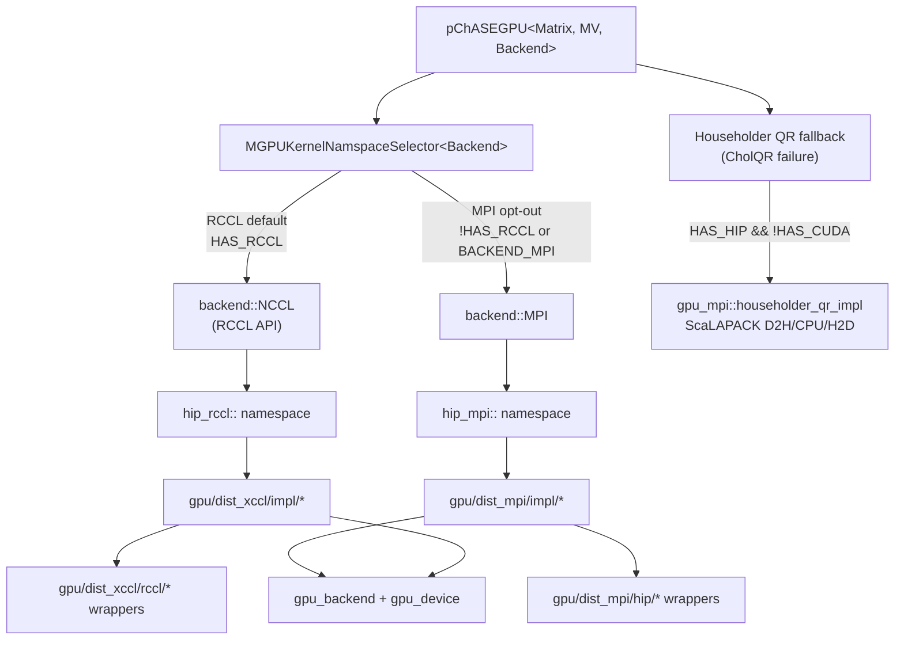
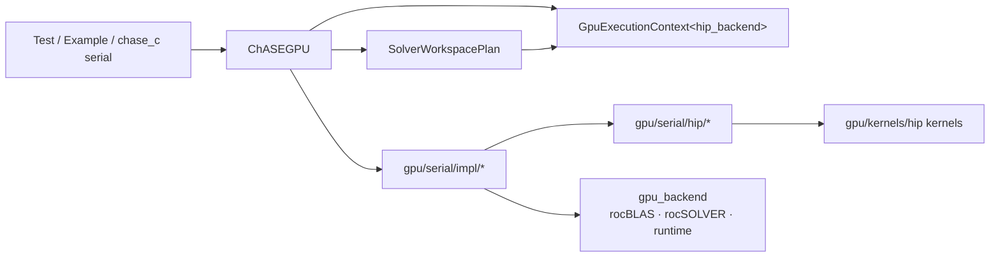
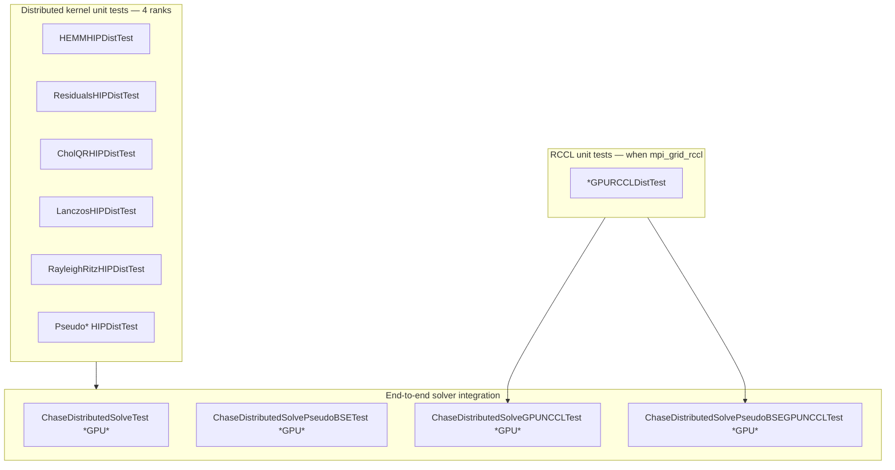

# HIP MPI adapter (Phase 4.1+)

> **gpu_mpi** — shared distributed kernels using GPU-aware MPI  
> **gpu_xccl** — shared distributed kernels using NCCL/RCCL device collectives

Distributed GPU kernels on ROCm-aware MPI (Frontier Cray MPICH).

Serial HIP algorithms live in `linalg/internal/gpu/serial/hip/` with shared
orchestration in `linalg/internal/gpu/serial/impl/` (CholQR, Rayleigh–Ritz,
residuals, and unified Lanczos in `lanczos_detail.hpp`). Shared device batched
orthogonalization kernels live in `linalg/internal/gpu/kernels/{hip,cuda}/launchers/orthog_kernels.hpp`
(not the full Lanczos algorithm). Cross-stack device hooks are in
`gpu/kernels/shared/` (`orthog_kernels.hpp`, etc.). This directory is the
**HIP MPI adapter**; shared algorithms live in `linalg/internal/gpu/dist_mpi/impl/`
and mirror the CUDA adapter at `linalg/internal/gpu/dist_mpi/cuda/`.

## Two-stack layout (nested)

```text
pchase_gpu → MGPUKernelNamspaceSelector
  MPI stack:   gpu/dist_mpi/impl/ → gpu/dist_mpi/cuda/ | gpu/dist_mpi/hip/
  XCCL stack:  gpu/dist_xccl/impl/ → gpu/dist_xccl/nccl/ | gpu/dist_xccl/rccl/
```

### Diagram — HIP distributed routing

On Frontier, `pChASEGPU` selects the collective stack at compile time. The HIP
MPI path is the default when RCCL is not linked; RCCL builds use the xCCL stack
with `hip_rccl` adapters.



### Diagram — serial HIP path (single GPU)

Serial solves (`ChASEGPU`) never touch `gpu_mpi` or `gpu_xccl`. They route
through `gpu/serial/impl/` and `gpu_backend::GpuExecutionContext`.



### Diagram — kernel unit tests → integration tests



| Layer | Directory | Namespace | Role |
|-------|-----------|-----------|------|
| Shared MPI impl | `gpu/dist_mpi/impl/` | `gpu_mpi::` | GPU-aware MPI algorithms |
| CUDA MPI adapter | `gpu/dist_mpi/cuda/` | `cuda_mpi::` | NVIDIA device kernels + MPI |
| HIP MPI adapter | `gpu/dist_mpi/hip/` | `hip_mpi::` | AMD device kernels + MPI |
| Shared XCCL impl | `gpu/dist_xccl/impl/` | `gpu_xccl::` | NCCL/RCCL algorithms |
| NCCL adapter | `gpu/dist_xccl/nccl/` | `cuda_nccl::` | NVIDIA NCCL wrappers |
| RCCL adapter | `gpu/dist_xccl/rccl/` | `hip_rccl::` | AMD RCCL wrappers |

CholQR and pseudo-Hermitian kernels on the XCCL stack may include shared impl
headers from `gpu/dist_mpi/impl/` (e.g. `cholqr_impl.hpp`) with XCCL collective policies.

## Phase 4.0

- `scripts/frontier_hip_env.sh` — `MPICH_GPU_SUPPORT_ENABLED=1`
- `cmake/tests/hip_mpi_test.cpp` — configure/run probe
- CMake target `hip_mpi_probe` when `CHASE_ENABLE_HIP=ON` and MPI is found

## Phase 4.1

- `hip_mpi` HEMM + device-buffer `MPI_Allreduce`
- `distMatrix` / `distMultiVector` GPU staging (`H2D` / `D2H`) for `HAS_HIP`
- `HEMMHIPDistTest` (4 ranks)

## Phase 4.2 — distributed kernels (verified on Frontier)

Hermitian and pseudo-Hermitian kernels + unit tests:

| Kernel | Test |
|--------|------|
| `hemm` | `HEMMHIPDistTest` |
| pseudo-HEMM (`flipSign` + HEMM) | `PseudoHEMMHIPDistTest` |
| `residuals` | `ResidualsHIPDistTest` |
| `shiftDiagonal` | `shiftDiagonalHIPDistTest` |
| `symOrHerm` | `SymOrHermHIPDistTest` |
| `cholQR1/2` (+ steps) | `CholQRHIPDistTest`, `CholQRHIPDistStepsTest` |
| `lanczos` | `LanczosHIPDistTest` |
| `rayleighRitz` | `RayleighRitzHIPDistTest` |
| `pseudo_hermitian_lanczos` | `PseudoHermitianLanczosHIPDistTest` |
| `pseudo_hermitian_rayleighRitz` | `PseudoRayleighRitzHIPDistTest` |

End-to-end distributed solver (C++ `pchase_gpu`, block-block GPU layout):

| Test | Filter |
|------|--------|
| `ChaseDistributedSolveTest` | `*GPU*BlockBlock*` (RCCL default / `backend::NCCL`) |
| `ChaseDistributedSolvePseudoBSETest` | `*GPU*` (RCCL default) |
| `ChaseDistributedSolveGPUNCCLTest` | `*GPU*BlockBlock*` (explicit RCCL / `backend::NCCL`) |
| `ChaseDistributedSolvePseudoBSEGPUNCCLTest` | `*GPU*` (explicit RCCL) |

When RCCL is linked, default integration tests use RCCL via
`DefaultDistributedGpu`. Configure `-DCHASE_HIP_DISTRIBUTED_COLLECTIVES=MPI` so
`ChaseDistributedSolveTest` uses GPU-aware MPI; `*GPUNCCLTest` variants remain
available for explicit RCCL regression.

## Verify on Frontier

Inside a GPU allocation:

```bash
source scripts/frontier_hip_env.sh
cmake -S . -B build-frontier-hip -DCHASE_ENABLE_HIP=ON -DCHASE_ENABLE_TESTS=ON ...
cmake --build build-frontier-hip

# Serial HIP kernel unit tests (gpu_serial + gpu_device)
srun -n 1 --gpus-per-task=1 bash scripts/run_hip_serial_unittests.sh

# All distributed kernel unit tests
srun -n 4 --gpus-per-task=1 bash scripts/run_hip_dist_unittests.sh

# Full HIP E2E (serial + distributed + interface smoke)
srun -n 4 --gpus-per-task=1 bash scripts/run_hip_e2e_tests.sh

# Include end-to-end solver tests (MPI + RCCL when *GPUNCCLTest* binaries exist)
CHASE_RUN_INTEGRATION=1 CHASE_INTEGRATION_COLLECTIVES=both \
  srun -n 4 --gpus-per-task=1 bash scripts/run_hip_dist_unittests.sh

# RCCL integration only
CHASE_RUN_INTEGRATION=1 CHASE_INTEGRATION_COLLECTIVES=nccl \
  srun -n 4 --gpus-per-task=1 bash scripts/run_hip_dist_unittests.sh
```

Or run individual binaries, e.g.:

```bash
srun -n 4 --gpus-per-task=1 ./build-frontier-hip/tests/linalg/internal/gpu/dist_mpi/hip/HEMMHIPDistTest
srun -n 4 --gpus-per-task=1 ./build-frontier-hip/tests/ChaseDistributedSolveTest \
  --gtest_filter='*GPU*BlockBlock*'
srun -n 4 --gpus-per-task=1 ./build-frontier-hip/tests/ChaseDistributedSolveGPUNCCLTest \
  --gtest_filter='*GPU*BlockBlock*'
```

## Shared MPI kernels (`gpu/dist_mpi/impl/`)

| Shared impl | Thin wrappers |
|-------------|---------------|
| `mpi_collectives.hpp` | used by all GPU-aware MPI paths |
| `hemm_impl.hpp` | `gpu/dist_mpi/cuda/hemm.hpp`, `gpu/dist_mpi/hip/hemm.hpp` |
| `flip_sign_impl.hpp` | `gpu/dist_mpi/cuda/flipSign.hpp`, `gpu/dist_mpi/hip/flipSign.hpp` |
| `shift_diagonal_impl.hpp` | `gpu/dist_mpi/cuda/shiftDiagonal.hpp`, `gpu/dist_mpi/hip/shiftDiagonal.hpp` |
| `residuals.hpp` | `gpu/dist_mpi/cuda/residuals.hpp`, `gpu/dist_mpi/hip/residuals.hpp` |
| `rayleighRitz_impl.hpp` | `gpu/dist_mpi/cuda/rayleighRitz.hpp`, `gpu/dist_mpi/hip/rayleighRitz.hpp` |
| `sym_or_herm_impl.hpp` | `gpu/dist_mpi/cuda/symOrHerm.hpp`, `gpu/dist_mpi/hip/symOrHerm.hpp` |
| `cholqr_impl.hpp` | `gpu/dist_mpi/cuda/cholqr.hpp`, `gpu/dist_mpi/hip/cholqr.hpp` |
| `lanczos_impl.hpp` | `gpu/dist_mpi/cuda/lanczos.hpp`, `gpu/dist_mpi/hip/lanczos.hpp` |
| `pseudo_hermitian_lanczos_impl.hpp` | `gpu/dist_mpi/cuda/pseudo_hermitian_lanczos.hpp`, `gpu/dist_mpi/hip/pseudo_hermitian_lanczos.hpp` |
| `pseudo_hermitian_rayleighRitz_impl.hpp` | `gpu/dist_mpi/cuda/pseudo_hermitian_rayleighRitz.hpp`, `gpu/dist_mpi/hip/pseudo_hermitian_rayleighRitz.hpp` |

Still CUDA-only: `gpu/dist_mpi/cuda/householder_qr.hpp` (GPU `houseQR1_formQ`).

The `gpu_mpi` layer deliberately keeps the historical algorithm wrapper names
(`shiftDiagonal.hpp`, `flipSign.hpp`, and friends) because those are the
distributed API names. The backend-neutral device kernel source layout lives
under `gpu/kernels/shared/device_kernels.hpp`, `gpu/kernels/shared/impl/`, and the
backend `launchers/` directories.

### Distributed Householder QR policy (NVIDIA vs AMD)

This is an **intentional** backend difference (see `docs/amd_port_convergence_plan.md`):

| Backend | Distributed Householder QR fallback |
|---------|-------------------------------------|
| **NVIDIA** | Custom GPU `houseQR1_formQ` (`gpu/dist_mpi/cuda/householder_qr.hpp`, NCCL variants in `gpu/dist_xccl/nccl/`) |
| **AMD / Frontier** | **ScaLAPACK** CPU path: `gpu_mpi::householder_qr_impl` (`pgeqrf` / `pgqr` after D2H), selected from `pChASEGPU::QR` when `HAS_HIP && !HAS_CUDA` |

CholQR remains the primary GPU orthonormalization path on both backends. HIP
distributed builds should enable ScaLAPACK (`HAS_SCALAPACK`). Example 6
(`householder_block_cyclic_benchmark`) is a **CUDA-only** showcase for the NVIDIA
GPU Householder path.

Distributed `houseHoulderQR` in CholQR uses the shared ScaLAPACK CPU path
(`gpu_mpi::householder_qr_impl`) on HIP; NVIDIA may use the GPU path above.

## Shared XCCL kernels (`gpu/dist_xccl/impl/`)

Separate from `gpu/dist_mpi/` (MPI collectives). NVIDIA NCCL behavior is the
reference; RCCL uses the same impl with `collective_hip_backend`.

| Shared impl | Thin wrappers |
|-------------|---------------|
| `collectives.hpp`, `backend.hpp` | used by all NCCL/RCCL kernel paths |
| `hemm_impl.hpp` | `gpu/dist_xccl/nccl/hemm.hpp`, `gpu/dist_xccl/rccl/hemm.hpp` |
| `rayleigh_ritz_impl.hpp` | `gpu/dist_xccl/nccl/rayleighRitz.hpp`, `gpu/dist_xccl/rccl/rayleighRitz.hpp` |
| `lanczos_impl.hpp` | `gpu/dist_xccl/nccl/lanczos.hpp`, `gpu/dist_xccl/rccl/lanczos.hpp` |
| `residuals.hpp` | `gpu/dist_xccl/nccl/residuals.hpp`, `gpu/dist_xccl/rccl/residuals.hpp` |

RCCL wrappers use the separate `gpu/dist_xccl/impl/` algorithm bodies. Do not
route RCCL through `gpu/dist_mpi/impl/`: the MPI-aware and xCCL paths have
different collective behavior and are tested independently.

## Deferred / follow-up

- **RCCL kernels (`linalg/internal/gpu/dist_xccl/rccl/`)** — ported: `flipSign`, `shiftDiagonal`,
  `residuals`, full `hemm`, `symOrHerm`, `rayleighRitz`, `cholQR`, `lanczos`,
  `pseudo_hermitian_lanczos`, `pseudo_hermitian_rayleighRitz` (+ v2).
  Tests: `*GPURCCLDistTest` via `scripts/run_hip_dist_unittests.sh`. Remaining
  NCCL kernels (`householder_qr`, …) still to migrate.
- **GPU `householder_qr` on HIP** — intentionally **not ported**. AMD uses
  ScaLAPACK via `householder_qr_impl`; NVIDIA keeps GPU `houseQR1_formQ`. See
  `docs/amd_port_convergence_plan.md`.
- **MPI sync audit** — HEMM/filter uses stream-aware `mpiAllreduceSum` (sync
  rocBLAS stream before MPI, no post-MPI device sync), matching CUDA Householder
  QR. Other call sites still use full device sync before/after collectives.

### MPI collectives

`hip_mpi_utils` uses **device-pointer** MPI (`mpiAllreduceSum`, `mpiBcast`,
`mpiSendrecv`). HEMM passes the rocBLAS stream into `mpiAllreduceSum` so only
that stream is synchronized before the collective (no post-MPI device sync).
Other paths still use full device synchronize before/after each call via
`gpu_backend::runtime<active_backend>`, so CUDA and HIP share the same
GPU-aware MPI policy without legacy CUDA utilities.
Requires GPU-aware MPI (`MPICH_GPU_SUPPORT_ENABLED=1` on Frontier via
`scripts/frontier_hip_env.sh`).
